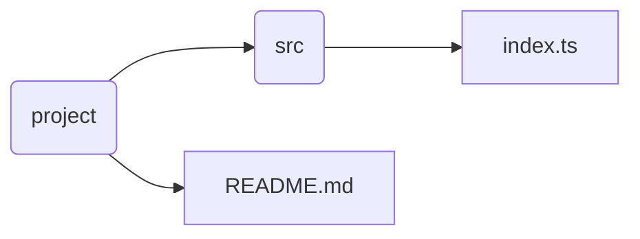

# Начало работы

> Это расширение сделано Дреем Даниилом Александровичем, группа M3102, ISU ID: 558295.  

**Graph-extention** сделано чтобы автоматически генерировать Mermaid граф дерева вашего проекта, чтобы
использовать его в документации и README.

## Требования

Минимальная версия VS Code: **1.139.0**

## Установка

Расширение находится в виде файла `.vsix` (имя файла вида `graph-extension-<version>.vsix`).

* Через командную строку: `code --install-extension graph-extension-<version>.vsix`
* Через интерфейс: откройте панель расширений (Ctrl + Shift + X), нажмите "..." в ее верхней части и выберите "Install from VSIX...", потом выберите файл.

## Использование

1. Откройте ваш проект в VS Code.
2. Нажмите Ctrl + Shift + P. В поле ввода напишите: "Make graph" и нажмите Enter.
3. Поздравляем, теперь в рабочей директории есть graph.md.
4. Чтобы увидеть граф, откройте этот файл и нажмите Ctrl + Shift + V.

## Возможности

Это расширение сканирует ваше рабочее пространство (если оно не открыто, будет выведена ошибка) и создает в нем graph.md.

* Файлы и директории добавляются в граф как узлы, каждый узел соединен со своей родительской директорией.
* Директории, имена которых совпадают с `build` или содержат точку (например `.git`), игнорируются.
* Если graph.md уже существует, он будет перезаписан.

## Пример graph.md

````

````

Больше информации о коде есть в docs.md.